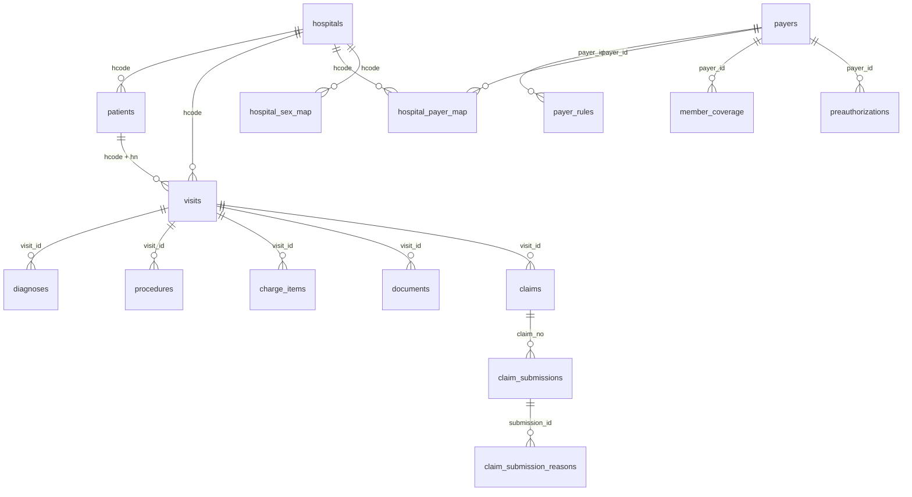

# Claims Hub Database (ข้อมูลจำลอง)

ฐานข้อมูลของระบบตัวกลางรับส่งเคลม (claims hub) ที่เชื่อมกับ HIS ของ 4 โรงพยาบาล และ payer 5 ราย
ข้อมูลจาก HIS ถูกดึงเข้ามา **ตามรูปแบบเดิมของแต่ละโรงพยาบาล** และยังไม่ผ่านการปรับมาตรฐาน

- ไฟล์: `claims_hub.sqlite` (SQLite 3 เปิดได้ด้วย DB Browser for SQLite, DBeaver, VS Code SQLite extension หรือ `sqlite3`)
- ช่วงวันที่รับบริการ: 1 ส.ค. – 30 ก.ย. 2569
- ข้อมูล ณ วันที่: 8 ต.ค. 2569

> ข้อมูลทั้งหมดเป็นข้อมูลสังเคราะห์ ไม่มีข้อมูลผู้ป่วยจริง ชื่อ เลขบัตรประชาชน เบอร์โทร โรงพยาบาล และบริษัทประกันเอกชนเป็นของสมมติ
> รหัส ICD-10 / ICD-9-CM เป็นชุดย่อยเพื่อการเรียน ไม่ใช่รายการ ICD-10-TM ทางการ รหัสยาเป็นรหัสสมมติที่เลียนรูปแบบ TMT
> กฎของ payer ภาครัฐเป็นฉบับย่อเพื่อการเรียน ไม่ใช่กฎจริงของ สปสช. กรมบัญชีกลาง หรือประกันสังคม

## ภาพรวมตาราง



| กลุ่ม | ตาราง | จำนวนแถว | คืออะไร |
|---|---|---|---|
| Master | `hospitals` | 4 | โรงพยาบาลที่เชื่อมต่อ |
| | `payers` | 5 | ผู้จ่ายเงิน (สิทธิภาครัฐ 3, ประกันเอกชน 2) |
| | `payer_rules` | 69 | เงื่อนไขการเบิกของแต่ละ payer (มีเวอร์ชัน) |
| | `hospital_payer_map` | 20 | รหัสสิทธิของแต่ละ รพ. → payer |
| | `hospital_sex_map` | 8 | รหัสเพศของแต่ละ รพ. → male/female |
| Reference | `ref_icd10` | 14 | รหัสโรค |
| | `ref_icd9cm` | 4 | รหัสหัตถการ |
| | `ref_drug` | 13 | รายการยา |
| | `ref_service_item` | 13 | รายการค่าบริการ |
| | `ref_reject_reason` | 16 | รหัสเหตุผลการปฏิเสธของ payer |
| ข้อมูลจาก รพ. | `patients` | 400 | ผู้ป่วย |
| | `visits` | 400 | การมารับบริการ |
| | `diagnoses` | 449 | การวินิจฉัย |
| | `procedures` | 77 | หัตถการ |
| | `charge_items` | 1,765 | รายการค่าใช้จ่าย |
| | `documents` | 386 | เอกสารประกอบ |
| เคลม | `claims` | 412 | เคลมที่สร้างจาก visit |
| | `claim_submissions` | 317 | ประวัติการส่งเคลมและผลตอบกลับ |
| | `claim_submission_reasons` | 208 | เหตุผลที่ payer ปฏิเสธหรือจ่ายบางส่วน |
| ข้อมูลจาก payer | `member_coverage` | 400 | ทะเบียนสิทธิ/สมาชิก |
| | `preauthorizations` | 27 | การอนุมัติล่วงหน้า |

## รายละเอียดคอลัมน์

### hospitals
| คอลัมน์ | ความหมาย |
|---|---|
| hcode | รหัสสถานพยาบาล |
| hospital_name | ชื่อโรงพยาบาล |
| his_system | ช่องทางที่ hub ใช้ดึงข้อมูลจาก HIS |
| date_format | รูปแบบวันที่ที่ รพ. นี้ส่งมา |

### payers
| คอลัมน์ | ความหมาย |
|---|---|
| payer_id | รหัส payer ที่ hub ใช้ |
| scheme | UCS (บัตรทอง), CSMBS (ข้าราชการ), SSS (ประกันสังคม), PRIVATE |
| payer_type | public / private |
| realtime_eligibility | 1 = ตรวจสิทธิแบบ real-time ได้ |
| preauth_via_api | 1 = ขออนุมัติล่วงหน้าผ่าน API ได้ |
| submission_channel | ช่องทางส่งเคลม: api / batch_file / portal |

### payer_rules
หนึ่งแถว = หนึ่งเงื่อนไข ใช้กฎของเวอร์ชันล่าสุดที่ `effective_from` ไม่เกินวันรับบริการ

| คอลัมน์ | ความหมาย |
|---|---|
| rule_version | ชื่อเวอร์ชันกฎ |
| effective_from | วันที่กฎเริ่มใช้ (ค.ศ.) |
| rule_type | ประเภทเงื่อนไข (ดู `description`) |
| rule_value | ค่าของเงื่อนไข เช่น ชื่อฟิลด์บังคับ, จำนวนเงิน, prefix รหัสโรค |

ค่า `rule_value` ของ `required_field` อ้างชื่อฟิลด์ในรูปแบบเคลมมาตรฐาน เช่น `patient.nationalId`, `encounter.attendingLicense`, `insurance.policyNumber`, `diagnosis.principal`, `encounter.chiefComplaint`

### patients
| คอลัมน์ | ความหมาย |
|---|---|
| hcode, hn | รหัส รพ. + เลขประจำตัวผู้ป่วยของ รพ. นั้น |
| cid | เลขประจำตัวประชาชน |
| prename, fname, lname | คำนำหน้า ชื่อ นามสกุล |
| sex | รหัสเพศตามที่ รพ. ใช้ (ดู `hospital_sex_map`) |
| birth_date | วันเกิด ตามรูปแบบวันที่ของ รพ. |

### visits
| คอลัมน์ | ความหมาย |
|---|---|
| visit_id | เลขที่ visit (VN/AN) |
| visit_type | OPD / IPD |
| service_date | วันที่รับบริการ |
| admit_date, discharge_date, los | วันรับไว้ วันจำหน่าย จำนวนวันนอน (เฉพาะ IPD) |
| chief_complaint | อาการสำคัญ |
| doctor_license | เลขใบประกอบวิชาชีพแพทย์ผู้รักษา |
| pttype | รหัสสิทธิตามที่ รพ. ใช้ (ดู `hospital_payer_map`) |
| policy_no | เลขกรมธรรม์ (ประกันเอกชน) |
| preauth_no | เลขที่อนุมัติล่วงหน้า |

วันที่ทุกคอลัมน์ในตาราง `patients`, `visits`, `procedures` เป็นรูปแบบของแต่ละ รพ. ตาม `hospitals.date_format`

### diagnoses / procedures
| คอลัมน์ | ความหมาย |
|---|---|
| seq | ลำดับ |
| icd10 | รหัสโรค |
| diag_type | 1 = การวินิจฉัยหลัก, 2 = การวินิจฉัยรอง |
| icd9cm, op_date | รหัสหัตถการ และวันที่ทำ |

### charge_items
| คอลัมน์ | ความหมาย |
|---|---|
| item_type | DRUG / SERVICE |
| item_code | DRUG → `ref_drug.drug_code`, SERVICE → `ref_service_item.item_code` |
| qty, unit_price, amount | จำนวน ราคาต่อหน่วย จำนวนเงิน (บาท) |

### documents
| คอลัมน์ | ความหมาย |
|---|---|
| doc_type | discharge_summary, itemized_bill, operative_note, pathology_report |
| doc_ref | เลขอ้างอิงเอกสาร |

### claims
| คอลัมน์ | ความหมาย |
|---|---|
| claim_no | เลขที่เคลม |
| visit_id | visit ที่เคลมนี้เรียกเก็บ |
| claim_amount | ยอดเรียกเก็บ (บาท) |
| claim_status | `submitted` = ส่งแล้ว, `pending` = รอส่ง |
| created_at | วันที่สร้างเคลม (ค.ศ.) |

### claim_submissions
| คอลัมน์ | ความหมาย |
|---|---|
| attempt_no | ครั้งที่ส่ง |
| submitted_at, response_at | วันที่ส่ง / วันที่ payer ตอบ (ค.ศ.) |
| response_status | approved / partial (จ่ายบางส่วน) / rejected / pended (payer ยังพิจารณา) |
| approved_amount | ยอดที่ payer อนุมัติ |
| paid_at | วันที่ได้รับเงิน (ว่าง = ยังไม่ได้รับ) |

### claim_submission_reasons
| คอลัมน์ | ความหมาย |
|---|---|
| reason_code | รหัสเหตุผล (ดู `ref_reject_reason`) — payer ที่ส่งผ่าน portal ไม่ให้รหัส มีแต่ข้อความ |
| field | ฟิลด์ที่มีปัญหา (ถ้า payer ระบุ) |
| message_th | ข้อความจาก payer |

### member_coverage
| คอลัมน์ | ความหมาย |
|---|---|
| cid, payer_id | ผู้มีสิทธิ และ payer |
| member_no | เลขสมาชิก / เลขกรมธรรม์ |
| start_date, end_date | ช่วงที่สิทธิมีผล (ค.ศ.) |

### preauthorizations
| คอลัมน์ | ความหมาย |
|---|---|
| preauth_no | เลขที่อนุมัติ |
| cid, payer_id, service_date | ผู้ป่วย payer วันที่รับบริการ (ค.ศ.) |
| status | สถานะ |
| icd10, approved_amount | รหัสโรคที่ขออนุมัติ และวงเงินที่อนุมัติ |

## ตัวอย่าง query

```sql
-- เคลมที่รอส่ง พร้อม payer
SELECT c.claim_no, v.visit_type, v.service_date, m.payer_id, c.claim_amount
FROM claims c
JOIN visits v USING (visit_id)
JOIN hospital_payer_map m ON m.hcode = v.hcode AND m.local_payer_code = v.pttype
WHERE c.claim_status = 'pending';

-- เหตุผลที่ถูกปฏิเสธบ่อยที่สุด
SELECT r.reason_code, rr.description_th, COUNT(*) AS n
FROM claim_submission_reasons r
LEFT JOIN ref_reject_reason rr USING (reason_code)
GROUP BY 1, 2 ORDER BY n DESC;
```
